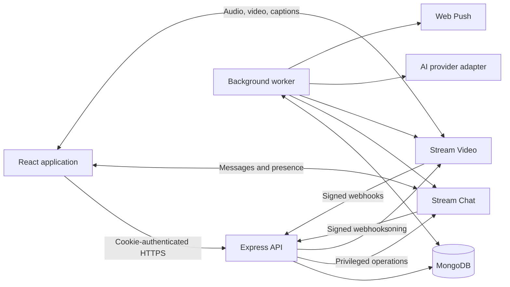

# Talkio architecture and integration plan

Prepared 14 October 2026. Status: architecture and implementation reference. The AI Lab, local inference path, optional server-assistance path, and benchmark tooling are implemented as an opt-in prototype; community and learning modules in this plan remain staged product architecture.

## 1. Product and architecture decisions

Build a peer-learning community around this journey:

**Discover a circle → converse → receive a correction → save a phrase → complete practice → return to the community.**

Retain React/Vite, Express, MongoDB/Mongoose, Stream Chat/Video, React Query, and cookie-based authentication. Organize the backend as a modular monolith with a separately deployed worker sharing the same codebase. Keep JavaScript for this expansion; introduce runtime request/response validation with Zod rather than coupling delivery to a TypeScript migration.

The first usable release is language circles, group chat, improved discovery, and moderation. The next adds text challenges, corrections, phrasebooks, and manually authored quizzes. Add AI assistance after those workflows work without it. Speaking rooms and translated captions follow as a gated pilot.

Planning defaults: invite-led beta; 50 members per circle; 8 participants per speaking room; text submissions first; no formal school gradebook, payments, general social feed, automated certification, voice cloning, or live translated audio in the initial releases. These are product caps, not provider limits. Support existing profile languages, but enable AI and captions only for evaluated language/locale combinations.

## 2. Current code and required foundation work

Observed in the current repository:

| Current behavior | Required change before expanding access |
|---|---|
| User discovery queries full User documents; login also serializes a full User document | Introduce explicit public and self-profile serializers. Exclude password hashes, push subscriptions, and private account fields from discovery and every unrelated response. |
| Push replies call the Stream server client with a caller-supplied channel ID | Verify channel membership, bans, account status, and channel type before sending. Server credentials bypass ordinary client permission enforcement. |
| Call notification accepts target, call ID, and caller display name from the browser | Create/authorize calls on the backend; derive identity from the session; validate target relationship and actual call membership before notifying. |
| Direct-message channels and ringing calls are created in the browser | Move privileged creation and membership changes behind backend services and align Stream grants. Preserve existing direct-message IDs and routes. |
| Webhook handler waits for push delivery and returns 200 even on internal failure | Persist a verified event before acknowledgement; process asynchronously; return a retryable error if persistence fails. |
| Recommendations exclude self/friends but do not rank language compatibility | Add deterministic compatibility ranking and cursor pagination. |
| Stream token helper supplies no explicit expiry | Add renewable, bounded-lifetime tokens and SDK token-provider callbacks; verify Chat and Video token requirements separately. |
| Express begins listening before database connection succeeds | Connect first; add liveness/readiness endpoints and graceful shutdown. |
| Root test script is a placeholder | Add backend integration tests, frontend interaction tests, and critical browser flows. |
| Repository includes tracked dependency files and existing local changes | Preserve current work. Make dependency-tracking cleanup a separate reviewed change; do not regenerate or delete existing work while implementing features. |

Relevant integration points: `backend/src/server.js`, `backend/src/controllers/webhook.controller.js`, and `frontend/src/components/StreamVideoProvider.jsx`. These findings are code observations, not a production security audit; dashboard permissions and deployed configuration were not inspected.

## 3. Runtime topology and ownership



| System | Owns | Does not own |
|---|---|---|
| MongoDB | Accounts, circles, desired membership, learning records, permissions, jobs, usage, audit events | A duplicate general-purpose message archive |
| Stream Chat | Message history, delivery, unread state, reactions, threads, presence; actual enforced chat membership | Authoritative learning scores or circle administration |
| Stream Video | Call media, connection state, actual call membership, caption transport | Learning records or authorization policy decisions |
| Express | Authentication, authorization, validation, orchestration, public API | Long-running media processing |
| Worker | Provisioning retries, notifications, AI generation, reconciliation, deletion work | Arbitrary direct client access |
| AI provider | Bounded inference requests | Membership decisions, publication authority, grading source of truth |

Do not add another WebSocket server, vector database, or agent framework for the MVP. Use short polling for job completion and React Query for ordinary app state. Add private object storage only when audio assignments are introduced; do not store audio blobs in MongoDB.

Deploy one API instance and one worker initially, backed by a MongoDB replica set so transactions are available. Use MongoDB-backed durable jobs/outbox first, avoiding a Redis dependency. Introduce a dedicated queue only if measured queue contention or throughput warrants it.

## 4. Module boundaries and data model

Organize backend modules around `identity`, `communities`, `messaging`, `learning`, `ai`, `sessions`, `notifications`, and `moderation`. Each module contains its routes, validators, service, and persistence logic. Controllers never invoke provider SDKs directly. Provider adapters sit behind services. Shared infrastructure contains authentication, configuration, logging, jobs, and error handling.

Frontend feature folders follow the same domains. Keep one authenticated Chat client and one Video client per signed-in user; feature screens subscribe and unsubscribe without globally disconnecting clients. Clear user-scoped caches and disconnect providers on logout or account switch.

All new Mongo records use timestamps, explicit ownership, and version fields where concurrent edits matter. References use ObjectIds internally and strings at API boundaries.

| Entity | Essential data and invariants |
|---|---|
| User extensions | Interests, learning goals, IANA time zone, optional availability, correction preference, account status. Language arrays remain canonical; retain legacy singular fields during migration. |
| Circle | Name, description, language code, proficiency range, topic tags, owner ID, visibility (`listed` or `invite_only`), Stream channel ID, lifecycle (`provisioning`, `active`, `archived`, `failed`). Listed means metadata is discoverable; messages remain members-only. |
| Membership | Circle/user IDs; role (`owner`, `moderator`, `member`); state (`invited`, `joining`, `active`, `removing`, `left`, `banned`); provider sync status and version. Unique circle/user pair. Exactly one owner; transfer ownership before leaving. |
| Correction | Channel/message reference, original text hash, proposed text, explanation, author, recipient, status. A correction annotates a message; it never overwrites it. |
| Phrase | Owner, language, phrase, meaning, example, optional source reference, next-review date and review stage. Private by default. |
| Challenge | Circle, author, prompt, language/level, optional due date, status (`draft`, `published`, `closed`, `archived`). Text-only initially; rubric is descriptive feedback, not a certification score. |
| Submission | Challenge/user, text, revision, timestamps, late flag. Unique challenge/user pair; resubmission updates revision. Feedback references the reviewed revision. |
| Feedback | Submission and revision, author, comment, optional corrected text, helpful mark by submitter. Authors cannot mark their own feedback helpful. |
| Quiz + QuizVersion | Owner or circle, draft/published state, immutable published question version, provenance. Version stores answer keys separately from learner response serializers. |
| QuizAttempt | User, quiz version, answers, score, submitted time, completion request ID. Scores are calculated server-side once per attempt. |
| ReviewEvent | Phrase/user, result (`again` or `remembered`), prior version, timestamp. Retry-safe and used to update the next review date. |
| LearningSession | Circle, host, scheduled time in UTC, duration, capacity, spoken language, call reference, lifecycle. Participant records track reservations and attendance. |
| AIJob / UsageEvent | Requester, feature, authorized source references, prompt/model versions, status, output reference, reserved/actual usage and errors. |
| OutboxJob / WebhookReceipt | Unique dedupe key, event kind, resource/version, lease, attempts, next run time and outcome. Store minimal payloads. |
| Notification / Report / Block / AuditEvent | Recipient or actor, scoped references, status. Moderator decisions have audit trails. Blocks are unique actor/target pairs. |

Indexes: memberships `(circleId,userId)` unique and `(userId,state)`; circles `(status,languageCode,createdAt,_id)`; submissions `(challengeId,userId)` unique; phrases `(ownerId,nextReviewAt)`; attempts `(userId,submittedAt)`; jobs `(status,nextRunAt,leaseUntil)`; unique webhook and operation keys. Add TTL indexes for ephemeral results, but enforce expiration in queries because TTL deletion is asynchronous.

Normalize language identifiers through a shared catalog using BCP-47 where a locale matters. Map existing stored display labels explicitly; preserve unmapped values for repair instead of guessing. User matching compares base languages; pronunciation and captions require provider-specific locale support.

## 5. API contracts and access rules

Keep existing `/api/auth`, `/api/users`, and `/api/chat` contracts compatible during migration. New routes use `/api/v1`. Return `{data, meta?}` on success and `{error:{code,message,requestId,details?}}` on failure. Lists use an opaque cursor, default 20 and maximum 50 items. Store UTC timestamps and format using the user's time zone.

All mutations require the existing session and CSRF protection except independently signed provider webhooks. Validate lengths and enum values before service calls. Use resource-level authorization on every read, write, background job, and cached-result fetch. Return 404 for resources whose existence the caller cannot see; use 403 for forbidden actions on visible resources.

| API surface | Contract and policy |
|---|---|
| `GET /api/v1/discovery/partners` | Return public profiles and matching reasons. Rank reciprocal pairs first, then one-way language fit, then optional shared interests/availability; stable ID tie-break and paginated results. Exclude blocked/suspended accounts. |
| `GET/POST /api/v1/circles` | List visible metadata or create a circle. Creation returns 202 with resource and provisioning status. |
| `GET/PATCH /api/v1/circles/:id` | Read permitted metadata; owner/moderator edits allowed descriptive fields. Ownership changes require a dedicated owner-only transfer action. |
| `POST /api/v1/circles/:id/join` and `/leave` | Listed circles can be joined within capacity. Invite-only joins require a matching unexpired invite. Return pending status until Stream synchronization succeeds. |
| `POST /api/v1/circles/:id/invitations` | Owner/moderator invites registered users; default seven-day expiry. Acceptance is by the invited user. |
| `PATCH /api/v1/circles/:id/members/:userId` | Owner changes moderator roles; owner/moderator removes or bans ordinary members. Moderators cannot remove owners or promote themselves. |
| `POST /api/v1/conversations/direct` | Resolve/create an authorized friend DM and return channel reference; preserve sorted legacy IDs. |
| `POST /api/v1/messages/:messageId/corrections` | Body includes channel reference, proposed text, explanation. Verify source message and both parties' current access. Respect recipient correction preference. |
| `POST /api/v1/messages/:messageId/translation` | Body includes channel reference and target language; fetch text server-side. Return cached result or 202 job reference. |
| `GET/POST /api/v1/me/phrases`, `DELETE /api/v1/me/phrases/:id` | Private phrasebook; server verifies source access if saving from a message. |
| `GET /api/v1/me/reviews`, `POST /api/v1/me/phrases/:id/reviews` | Due phrases and retry-safe review results. |
| `/api/v1/circles/:id/challenges` | GET lists visible challenges; POST creates drafts for owner/moderator. PATCH challenge edits drafts; explicit publish/close actions control lifecycle. |
| `/api/v1/challenges/:id/submission` | PUT creates/revises own submission; GET retrieves own. Separate circle-scoped submission list and feedback routes support peer review. |
| `/api/v1/quizzes`, `/api/v1/quizzes/:id/publish` | Host-authored circle quizzes and private personal quizzes; publishing creates an immutable version. |
| `POST /api/v1/quizzes/:id/attempts` | Submit answers against a version. Learner question responses exclude answer keys and explanations until submission. |
| `POST /api/v1/ai/jobs`, `GET /api/v1/ai/jobs/:id` | Allowlisted tasks and owned/authorized sources; jobs are visible only to the requester. No arbitrary system prompts or model selection from the client. |
| `/api/v1/circles/:id/sessions`, `POST /api/v1/sessions/:id/join` | Host creates session; member reserves/joins subject to capacity and lifecycle. Backend grants provider membership. |
| `POST /api/v1/reports`, `POST/DELETE /api/v1/me/blocks/:userId` | Reports persist even if content is removed. Blocking prevents new direct contact and notifications, but does not pretend to remove shared-group access. |
| `GET /api/v1/moderation/reports`, `POST /api/v1/moderation/reports/:id/actions` | Scoped report queue and audited resolution; platform staff handle account sanctions and escalations. |

Create, join, attempt submission, review, and generation operations accept an `Idempotency-Key`. Scope keys to user and operation, retain for 24 hours, and return the original outcome on replay. Reject key reuse with a different body. Use optimistic versions for editing drafts and submissions; return 409 for conflicts.

Set bounded route-specific JSON limits for quizzes and challenges instead of globally increasing the current 10 KB parser limit. File uploads, when introduced, go directly to private object storage via short-lived upload grants with type, size, and owner validation.

## 6. Stream integration and distributed consistency

Use one explicit `circle-<mongoId>` channel per circle. Do not derive group channel identity from its current membership; members must be able to join and leave. Stream documents explicit IDs and server-side creation as supported patterns. [Source](https://getstream.io/chat/docs/javascript/creating-channels/?language=javascript)

Configure member-only reads/writes and restrict channel creation, role changes, invitations, and membership management to the backend. Verify effective grants with unauthorized-client tests in staging; backend checks alone cannot restrict a browser talking directly to Stream.

Circle provisioning flow:

1. In a Mongo transaction, create a provisioning circle, its owner membership, and an outbox job with a deterministic key.
2. Worker creates/gets the Stream channel and mirrors approved members and roles.
3. Mark circle and membership active only after provider success. The UI shows a pending state until then.
4. Retry transient failures; show a recoverable failed state after retry exhaustion. Never silently create a second channel.

Membership changes use the same desired-state workflow. A transaction reserves a group seat before provider admission; conditional updates enforce capacity under concurrent joins. Serialize synchronization per circle and ignore superseded membership versions. Reconciliation compares desired Mongo state to Stream and repairs drift every five minutes.

For removal/ban, deny app APIs immediately and attempt provider revocation immediately. Treat provider revocation as pending until confirmed: existing provider access may persist during an outage. Remove access from active calls as well as chat, alert on failures, and never display a completed revocation before acknowledgement. Blocking a DM must also update provider permissions; hiding a UI is not enforcement.

For existing DMs, audit actual memberships and tighten creation grants only after backend creation is deployed. Do not delete existing message history. Existing non-friend channels may retain read history for current members, but require friendship and no block for new sends/calls; verify this policy can be enforced in provider grants/channel state before enabling it.

Signed webhook handling: validate raw bytes, minimally validate payload, persist a unique receipt and work item, then acknowledge. Prefer a provider event ID; where absent, use a documented stable event identity such as event type + message ID for `message.new`. Return 5xx on storage failure, 401 on invalid signatures. Duplicates acknowledge successfully without duplicate app notifications. Use a separate signed route for Video events.

Worker delivery is at least once. Jobs use atomic lease claims, lease renewal, bounded concurrency, and retries after roughly 1, 5, 30, 120, and 600 seconds with jitter. Permanent errors go to an inspectable failed queue. Side effects require deterministic provider IDs or explicit reconciliation; do not claim exactly-once push delivery. Use notification IDs as client dedupe tags.

For group pushes, default to mentions and moderator announcements. Resolve recipients from authoritative membership rather than assuming every webhook embeds a complete member list. Respect mutes, blocks, and bans. Notification links must include channel/circle identity; existing sender-based DM navigation cannot be reused for groups.

## 7. Learning behavior and state transitions

**Corrections:** fetch and authorize the source message; store a text hash and proposed correction. Only the original author accepts a correction. Source edits mark it stale; source deletion invalidates it and removes retained source excerpts. The recipient can save the accepted wording to a private phrasebook.

**Challenges/assignments:** hosts publish prompts; members submit text and review peers. Published prompts are immutable for existing submissions; material changes create a new challenge. Due dates set a late indicator, while explicit closure stops new submissions. Feedback remains tied to the submitted revision. Submitted work is visible to current circle members; drafts are private. Explain that visibility before submission.

**Quizzes:** support multiple-choice and fill-in-the-blank with author-approved accepted answers. Use Unicode normalization, whitespace normalization, and locale-aware case handling; do not strip accents globally. Score deterministically on the server. Freeze published versions so edits do not change historical attempts. Retakes are allowed and separately recorded; there are no public competitive leaderboards in v1.

**Phrase review:** begin with a simple schedule of 1, 3, 7, 14, and 30 days. Remembered advances a stage; again resets to one day. Atomic review updates prevent double advancement. Personal progress includes completed challenges, practice attempts, due reviews, and helpful feedback; do not equate these with certified proficiency.

**Message-derived content:** translations and correction source caches remain bound to source access and are removed or invalidated after edits/deletion. Explicitly saved phrases are independent private notes, with this behavior disclosed when saving. Removing a source severs its link; it does not republish private source text into a circle quiz. Group AI quiz generation accepts host-authored prompts or material explicitly submitted for that purpose, never arbitrary private conversations.

## 8. AI integration

The first runtime is optional on-device inference in the PWA through WebLLM. The browser uses a dedicated module worker and a version-pinned 4-bit MLC artifact; it never uploads user text as an implicit fallback. An allowlisted evaluation cohort can explicitly request server assistance through the authenticated Express API. The current server adapter calls OpenAI Responses with `store:false`; this is an optional prototype path and requires an operator-provided model ID, secret, and numeric daily cap. The API key never enters Vite or the browser.

Benchmark four MLC artifacts available in the pinned WebLLM release: Qwen3 0.6B and 1.7B, Qwen3.5 0.8B and 2B, all `q4f16_1`. Qwen3 0.6B is the smallest baseline. Upstream WebLLM configuration estimates range from about 1.4 GB to 2.25 GB GPU memory and are not device guarantees. Prepare one chosen artifact at a time with `npm run prepare:ai-model -- <model-id>`; `--inspect` resolves upstream metadata without downloading the model. Preparation streams files, checks upstream hashes, records local SHA-256 values and writes the manifest. Weight files are ignored by Git. For production, publish those files to HTTPS object storage/CDN with CORS, set `AI_ASSET_BASE_URL` when preparing, set the backend `AI_ASSET_ORIGIN` to the CDN origin, and deploy the generated `frontend/public/ai-models/catalog.json` with the backend. Keep WebLLM/runtime, model, tokenizer, wasm, hashes and manifest revision pinned together.

`GET /api/v1/ai/models` exposes only prepared candidates and their pinned metadata. `GET /api/v1/capabilities` reports whether a local model exists and whether the current account is allowlisted for experiments/server assistance. `/api/v1/ai/jobs` requires explicit `execution: "server"`, per-request `serverConsent: true`, an `Idempotency-Key`, and both per-user and deployment-wide quotas. `/api/v1/ai/jobs/:id` is owner-scoped. `/api/v1/ai/validate-draft` performs shape validation only; it does not publish quizzes. Local quiz drafts remain untrusted until the server validates them and a host reviews them.

Internal interface:

```text
generateLearningContent({task, language, level, authorizedInputs, schemaVersion})
  -> {validatedOutput, provider, model, promptVersion, usage}
```

Use structured outputs for typed results, then validate domain rules locally: correct options exist, questions are nonempty, answers match the requested language, and output length is bounded. Handle refusals and incomplete outputs explicitly. Schema compliance does not establish educational accuracy. [OpenAI structured outputs](https://developers.openai.com/api/docs/guides/structured-outputs?api-mode=responses)

Local execution checks secure context, WebGPU adapter/features, model storage, artifact hashes, and approval for the selected task/model/language pair. Cache downloads by immutable model revision, allow cancel/resume at file boundaries, load only in a worker, permit one generation, use a 2,048-token context/256-token response cap, and release after five idle minutes, tab backgrounding, logout, or call start. PWA model state is opt-in and user removable; model binaries are public artifacts, while prompts/results remain in memory unless explicitly saved. iOS browser support is capability detected rather than promised. The server flow is authenticate → explicit consent → validate → reserve idempotent quota → persist a short-lived job → worker rechecks access → call provider → validate → store result → owner polls. An uncertain billed timeout is not retried automatically.

Keep provider inputs limited to explicitly selected content, language, level, and task. Treat content as untrusted data; give the model no tools, database access, or publishing privileges. AI does not automatically participate in every group conversation. Do not log raw prompts or messages. Configure `store:false` for the optional server provider, while accurately disclosing that this does not itself establish zero provider retention. [OpenAI data controls](https://developers.openai.com/api/docs/guides/your-data)

Prototype limits: 20 assistance requests and 2 quiz generations per user/day; maximum 2,000 input characters for single-message help; maximum 10 questions per generated quiz. Reserve estimated maximum usage before inference and reconcile afterward. A deployment-wide spend limit is mandatory and must be configured before AI is enabled. Daily counters use UTC; show reset time locally. No automatic retries of ambiguous billed timeouts: show a retry action and record potentially incurred cost.

Use a 60-second server-worker timeout. Browser local inference stops on cancellation, backgrounding, call start, or timeout. Provider errors do not block messages or learning features. Do not automatically retry ambiguous billed requests. Current server jobs keep transient input/results for at most 24 hours and return only to their owner; review this retention before public rollout. Usage records must avoid raw prompts.

Evaluation gate: run at least 50 manually reviewed cases per task/model/language direction, including beginner errors, idioms, mixed script, and embedded instructions. Record local latency and reviewer verdicts in the AI Lab; export results for reproducibility. Require at least 90% reviewer acceptance, no more than five percentage points of quality loss against the higher precision baseline, a warm p95 first token below five seconds, and a short answer below 30 seconds on the approved device class. Keep task approvals empty until an evaluator updates and republishes the manifest after a passing review. The AI Lab now imports benchmark JSON, runs up to 50 cases for the selected task/direction, captures reviewer verdicts and baseline comparisons, and exports reports. Human review, additional batches, and approved device testing remain required before any task/language combination is enabled.

## 9. Speaking rooms and live translation

Extend the current Video provider with separate direct-call and group-session paths. Group sessions use scheduled joins rather than ringing every circle member. Host/moderator manages admission and speaker permissions; backend checks membership, lifecycle, and capacity before adding a caller. Synchronize attendance from signed provider events; never award speaking time from browser claims alone.

Stage 1: ordinary group audio, topic prompts, and an optional timer for balanced language practice. Stage 2: original-language captions. Stage 3: translated captions behind a separate feature flag and language allowlist.

Stream documents translated captions as beta requiring enablement and confirmation of language support. It requires active closed captions, uses the call's transcription language as source, and emits each target language as caption events. Handle events directly, key by caption ID plus language, replace revisions, and allow delayed arrival. Do not promise simultaneous multilingual source detection. [Stream translated captions](https://getstream.io/video/docs/api/transcribing/translated-captions/)

Pilot one spoken language per session and at most two translation targets. Participants choose what to display; the host controls call-level settings. Show caption processing disclosure before joining a caption-enabled room; enabling during a call requires acknowledgement from current participants. Do not retain transcripts or record calls by default. Keep captions only in a bounded client buffer. Provider feature access, billing, retention configuration, and SDK support must be verified before launch.

If the beta is unavailable, ship sessions without translated captions. A custom speech gateway or live translated audio is a separate later project requiring per-speaker audio routing, interruption handling, synchronization, and a new cost evaluation; do not silently add it as a fallback.

## 10. Frontend integration

Add `/circles`, `/circles/:id`, `/circles/:id/chat`, `/challenges/:id`, `/quizzes/:id`, `/learn`, and `/sessions/:id`. Preserve `/chat/:id` for existing DMs. Circle pages expose Overview, Chat, Challenges, and Sessions; personal learning lives under Learn. Member management appears only for authorized roles, with backend checks still mandatory.

Extend custom message rendering with Translate, Suggest correction, and Save phrase actions. Render learning activity messages as links to app resources; never trust message metadata as authorization. Preserve current call-status messages and threads. Provide pending, failed, empty, offline, and quota-exhausted states. Do not optimistically mark membership active or quiz attempts scored.

React Query owns backend resources; Stream owns chat/call state; Zustand remains for local UI preferences. Namespace query keys by signed-in user and resource. Invalidate after successful mutations, refresh on focus, and clear restricted views on access loss. Add a shared `PublicUser` view model and consistent API errors rather than more response-shape guessing.

## 11. Deployment, configuration, and operations

Keep the existing same-origin production frontend/API arrangement. Add a worker entrypoint deployed from the same revision. Separate staging and production Mongo databases, Stream applications, and AI credentials. Use managed secrets; expose only public Stream keys to Vite. Add scoped CSP entries only for providers actually enabled.

Configuration groups: database/session; Stream Chat/Video; AI provider/model and spend limits; Web Push; feature flags; worker concurrency/leases. Flags default off for new features and are enforced on the backend. `/api/v1/capabilities` returns enabled features, supported AI/caption languages, and applicable client limits; it never exposes secrets.

Start with Mongo transactions and an outbox in the same database. API readiness depends on Mongo, not optional AI availability. Shutdown stops new requests and releases worker leases safely. Run a graceful drain before deploy; lease expiry recovers crashed jobs.

Metrics: API errors/latency, job age/failures, provider membership drift, pending revocations, push outcomes, AI latency/usage, quiz-generation rejection rate, and caption delay. Correlate logs with request/job IDs and avoid message content. Alert on failed revocations immediately, queue age over two minutes for five minutes, and exhausted AI budget. Validate thresholds with actual beta traffic.

Proposed performance checks: p95 ordinary API responses below 500 ms and durable webhook acknowledgement below one second under a staging workload of 100 concurrent users with realistic pagination. Provider-dependent work is asynchronous and measured separately. These are test targets, not capacity claims.

Back up Mongo and test restoration before inviting external beta users. Archive circles before deletion. Account deletion immediately disables access, then uses retryable jobs to remove provider access, personal learning records, and derived caches; verify completion and retain only minimally necessary operational audit records under a documented retention policy.

Cost model: fixed API/worker/database hosting + Stream chat plan + call participant-minutes + caption/translation usage + AI input/output usage. Example: an eight-person, 30-minute session is 240 participant-minutes; verify which units and rates the actual Stream plan bills. Do not publish a monthly cost estimate without traffic assumptions and account pricing. Display usage internally by feature and measure cost per active learner.

## 12. Migration and delivery sequence

All releases are additive and independently flagged. Backfills have dry-run output, checkpoints, and repeatable transformations. Preserve existing DMs, friends, cookies, and call flows until replacements pass regression tests. Deploy schema readers before backfills/writers and tighten provider grants only after backend paths are ready.

| Milestone | Deliverables | Exit criteria |
|---|---|---|
| M0: Foundation | Safe serializers, reply/call authorization, bounded provider tokens, input contracts, readiness, test harness | No sensitive profile fields in responses; unauthorized provider operations rejected; existing chat/calls pass regression tests |
| M1: Community | Circle model/APIs/pages, membership state machine, worker/outbox, Stream grants, reporting/blocking, ranked discovery | Create/join/leave/ban survive crashes and retries; private data inaccessible through both API and SDK; group notifications route correctly |
| M2: Learning | Corrections, phrasebook/review schedule, challenges/submissions/feedback, manual quizzes and attempts | End-to-end conversation-to-practice journey works with AI disabled; scores and privacy rules verified |
| M3: AI assistance | PWA AI Lab, streamed model preparation, explicit local/server router, allowlisted jobs, quotas/evaluation | Artifact manifest and hashes verified; local data never uploads; per-user approvals and quotas enforced; task/language evaluation passes |
| M4: Speaking | Scheduled group sessions, host controls, attendance, original captions | Capacity and membership enforced; reconnects and mic denial handled; no accidental recording |
| M5: Translation pilot | Enabled Stream beta, language allowlist, caption UI and cost telemetry | Account/language support confirmed; delayed/revised captions handled; pilot feedback and cost reviewed before broader rollout |

Dependency chain: M0 → M1 → M2 → M3. M4 requires M1 and the call-authorization work; M5 requires M4 and provider enablement. Do not require M3 to release ordinary speaking rooms.

Release to the development team, then an allowlisted circle cohort, then broader beta. Roll back by disabling flags and reverting application revision while retaining additive data. Pause workers that execute incompatible new job types when rolling back. Reconcile provider state before re-enabling a failed feature; do not undo bans as a rollback shortcut.

## 13. Verification matrix

Use Node's test runner plus Supertest for backend service/API tests, a replica-set Mongo test environment for transaction cases, Vitest/React Testing Library for UI behavior, and Playwright for critical browser journeys. Mock provider adapters in CI and run a small real integration suite against a separate Stream staging app. Never run paid AI evaluation on every pull request.

| Area | Required scenarios |
|---|---|
| Privacy/auth | Discovery/login exclude secrets; anonymous/nonmember/cross-circle access denied; push-reply bypass blocked; call caller identity cannot be spoofed; expired tokens refresh; block prevents provider-level direct contact |
| Membership | Duplicate creation/join, concurrent last-seat joins, ownership transfer, remove during outage, stale job after rejoin, moderator privilege escalation, direct SDK access after removal |
| Jobs/webhooks | Invalid signature, duplicate delivery, database failure before acknowledgement, crash after provider success, expired lease, exhausted retries, out-of-order versions, notification dedupe |
| Learning | Source edited/deleted, correction accepted by wrong user, private phrase access, late submission, feedback on old revision, answer-key leakage, double attempt submission, accent-sensitive answers, immutable history |
| AI | Untrusted embedded instructions, invalid output/timeout, unsupported language, cache isolation, concurrent quota/idempotency requests, explicit-consent rejection, uncertain billed timeout, WebGPU loss, offline asset eviction, tab backgrounding, call interruption, logout, and runtime/model version mismatch |
| Calls/captions | Ninth participant denied, host leaves, reconnect, permission revocation, expired session, microphone denial, unsupported language, delayed/repeated caption events, target-language switch, no transcript persistence
|
| Regression | Signup/login/logout, onboarding, friend acceptance, old DM links, incoming/outgoing audio/video calls, push actions, themes, mobile navigation |

## 14. Decisions still requiring external validation

The architecture and release boundaries are specified. These deployment inputs cannot be inferred from repository code and must be recorded before the affected milestone ships:

- Stream plan, effective Chat/Video grants, region, and translated-caption beta availability.
- AI account access, a pinned model that passes the language benchmark, and a numeric deployment spend ceiling.
- Initial AI/caption language pairs and expected beta traffic. Core text community features do not depend on these selections.
- Actual production topology, backup retention, and provider data-retention settings.

No new infrastructure or paid services have been purchased or enabled as part of this plan.
